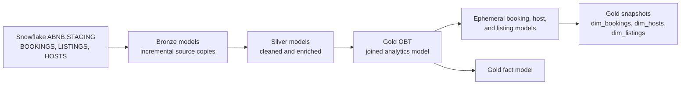

# Airbnb Sample Data Warehouse with dbt and Snowflake

This repository contains a dbt project that transforms Airbnb-style sample data in Snowflake. It reads bookings, listings, and hosts from the `ABNB.STAGING` schema and builds layered models for analytics.

The project uses `CREATED_AT` to incrementally select newer records. This is **incremental batch processing**, not a streaming or guaranteed real-time pipeline: freshness depends on how often dbt is run, and late-arriving rows with an older `CREATED_AT` may not be picked up by the current high-water-mark filters.

## Data flow



## Project layout

The dbt project is in `aws_snwflk_dbt/`. The Python project and uv-managed environment are in the repository root.

| Path | Purpose |
| --- | --- |
| `aws_snwflk_dbt/models/sources/sources.yml` | Declares the Snowflake staging sources. |
| `aws_snwflk_dbt/models/bronze/` | Incremental copies of staging bookings, hosts, and listings. |
| `aws_snwflk_dbt/models/silver/` | Incremental transformations for bookings, hosts, and listings. |
| `aws_snwflk_dbt/models/gold/` | Joined OBT and fact models, plus ephemeral intermediate models. |
| `aws_snwflk_dbt/snapshots/` | Timestamp-strategy snapshots for booking, host, and listing history. |
| `aws_snwflk_dbt/macros/` | Reusable SQL generation macros, including numeric categorization and arithmetic. |
| `aws_snwflk_dbt/analyses/` | Ad hoc SQL analyses; dbt compiles these but does not run them as models. |
| `aws_snwflk_dbt/tests/` | Location for singular data tests (currently no test queries are defined). |

### Current transformations

- **Bronze:** selects from the declared `ABNB.STAGING` sources and incrementally processes records newer than the target's maximum `CREATED_AT`.
- **Silver bookings:** derives per-night charges and excludes cancelled bookings.
- **Silver hosts:** normalizes spaces in host names and categorizes response rates.
- **Silver listings:** carries host/listing attributes and labels nightly prices as `LOW`, `MEDIUM`, or `HIGH`.
- **Gold:** joins bookings to listing and host information in an OBT. Ephemeral models shape booking, host, and listing records for the configured snapshots.

The project currently defines `unique_key` values on incremental models. A `unique_key` identifies rows for dbt's incremental merge; it does not enforce a database constraint or populate missing source values. Review the compiled SQL and source data when troubleshooting unexpected nulls or duplicate rows.

## Requirements

- Python 3.11 or later
- [uv](https://docs.astral.sh/uv/)
- Access to a Snowflake account with the `ABNB.STAGING` tables (`BOOKINGS`, `HOSTS`, and `LISTINGS`) and permission to create the configured target schemas

The Python dependencies are declared in `pyproject.toml`; `uv.lock` records the resolved environment.

## Set up

From the repository root:

```powershell
uv sync
Set-Location .\aws_snwflk_dbt
```

Configure the dbt profile named `aws_snwflk_dbt` for your Snowflake account. Prefer `%USERPROFILE%\.dbt\profiles.yml` rather than storing credentials in this repository. Supply the password through an environment variable and reference it in the profile with `{{ env_var('SNOWFLAKE_PASSWORD') }}`. Ensure your account, user, warehouse, role, database, and schema settings are correct. Do not commit passwords, tokens, or other secrets.

## Run dbt

Run these commands from `aws_snwflk_dbt/`. `uv run --project ..` selects the root uv environment, avoiding confusion with a different `dbt` executable on `PATH`.

```powershell
uv run --project .. dbt --version
uv run --project .. dbt debug
uv run --project .. dbt deps
uv run --project .. dbt parse
uv run --project .. dbt build
```

Useful targeted commands:

```powershell
# Build only the silver models
uv run --project .. dbt build --select path:models/silver

# Run one model
uv run --project .. dbt run --select silver_listings

# Rebuild one incremental model from all available source rows
uv run --project .. dbt run --full-refresh --select silver_listings

# Execute snapshot definitions
uv run --project .. dbt snapshot

# Compile SQL without executing it
uv run --project .. dbt compile

# Remove generated dbt artifacts
uv run --project .. dbt clean
```

`dbt build` runs selected models, tests, seeds, and snapshots according to the project graph. It does not execute files in `analyses/`; compile an analysis and run its SQL separately if needed. Always inspect destructive SQL before executing it.

## Incremental processing notes

The incremental models use `CREATED_AT` as a high-water mark. This is suitable only if new source records have timestamps later than the target's current maximum. If upstream records can be corrected in place, arrive late with older timestamps, or share timestamp values in a way that can split a batch, review the incremental strategy and watermark logic before relying on it for production.

Use `--full-refresh` when you intentionally need to rebuild an incremental relation after a schema or logic change. This replaces the target data, so verify the selected model and target before running it.

## Current project scope

This repository is a learning/demo project rather than a production-ready streaming platform. It declares Snowflake staging sources and transformations, but does not include the upstream ingestion job, a scheduler, freshness SLAs, or a populated automated test suite. Add source/model tests, freshness checks, and orchestration appropriate to your environment before operational use.
